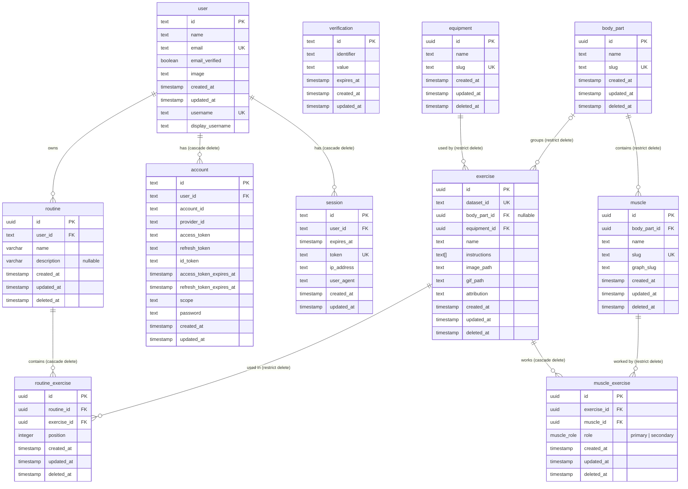

# Database Structure

Entity relation diagram of the current PostgreSQL schema, generated from the Drizzle schemas in `database/src/schemas/` and `database/src/relations.ts`.

## Notes

- `user`, `session`, `account` and `verification` are the auth tables (better-auth). `verification` has no foreign keys.
- `body_part`, `muscle`, `equipment`, `exercise`, `muscle_exercise`, `routine` and `routine_exercise` are soft-deleted via `deleted_at`.
- `muscle.graph_slug` is stored as text but constrained in Zod to the region ids used by `react-muscle-highlighter`.
- `exercise` rows are imported from the exercises dataset by the seeder. `dataset_id` is the dataset's four-digit id and the seeder's upsert key. `image_path` and `gif_path` are relative to the media root served by nginx under `/media/`.
- `exercise.body_part_id` is nullable: cardio exercises have no body region.
- `muscle_exercise` links exercises to the muscles they work. One row per (exercise, muscle) pair, enforced by a unique index; `role` is `primary` or `secondary`.
- `routine` belongs to a `user`. Ownership is checked in the queries (`user_id` + `deleted_at IS NULL`); deletes are soft.
- `routine_exercise` links a routine to its exercises. One row per exercise slot, ordered by `position` within the routine. The same exercise may appear more than once (e.g. supersets), so there is no unique index on `(routine_id, exercise_id)`, and `position` is not unique either so reorders don't trip a constraint. Sets/reps are not stored here.
- Indexes: `session.user_id`, `account.user_id`, `verification.identifier`, `muscle.body_part_id`, `exercise.body_part_id`, `exercise.equipment_id`, `muscle_exercise.(exercise_id, muscle_id)` (unique), `muscle_exercise.muscle_id`, `routine.user_id`, `routine_exercise.routine_id`, `routine_exercise.exercise_id`.
